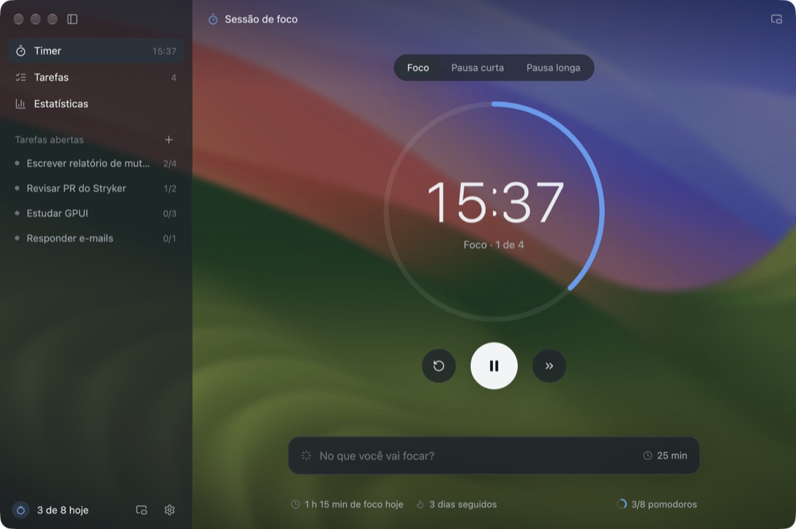
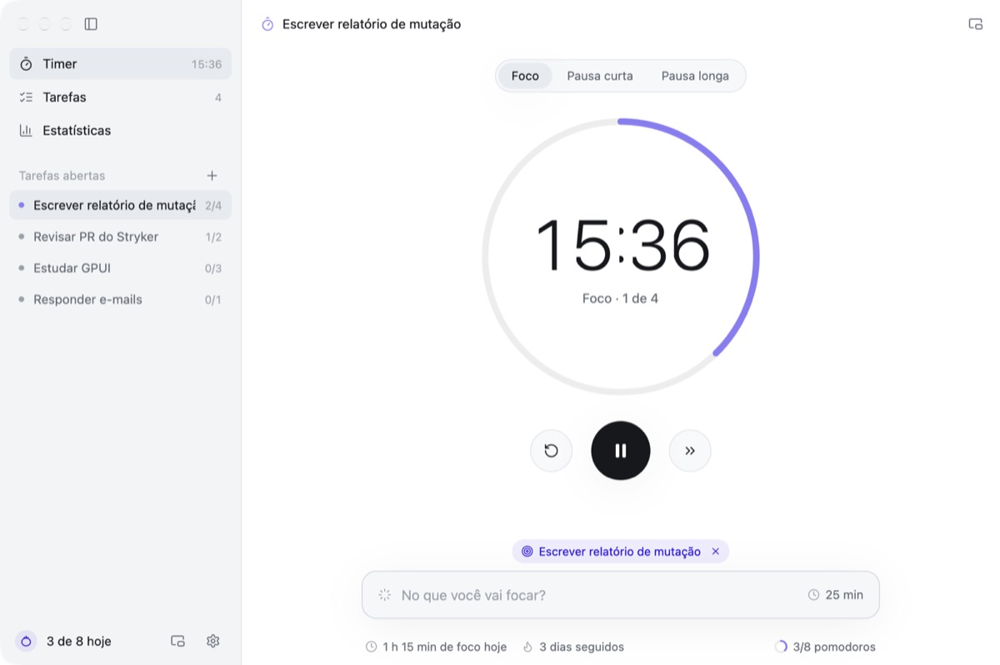
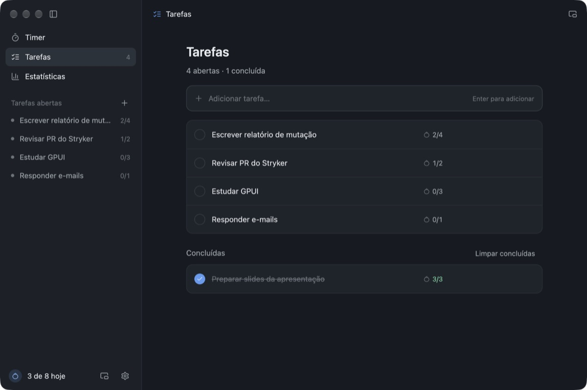
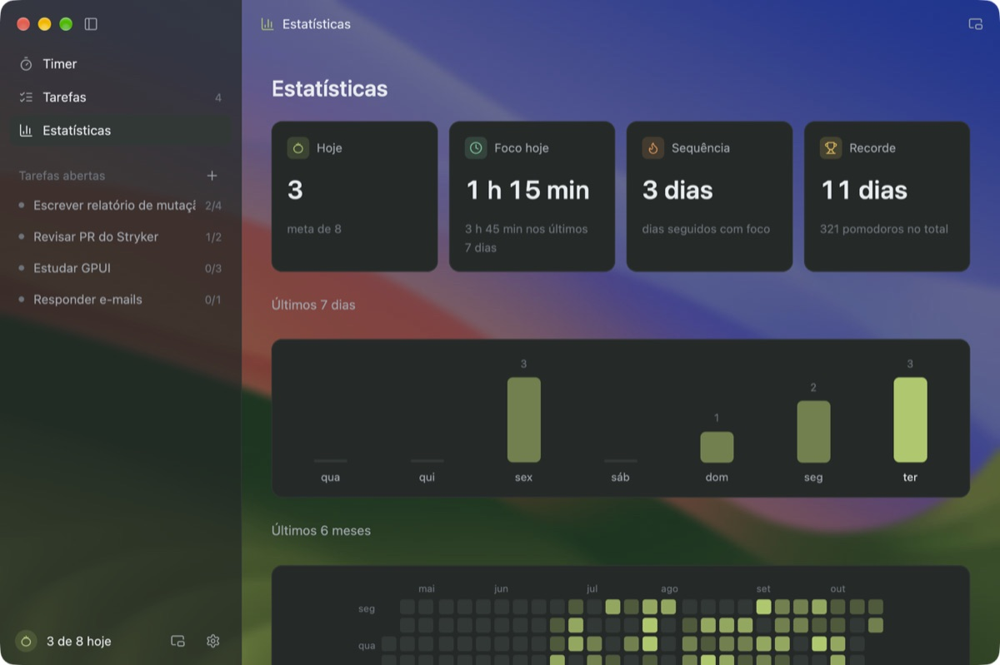
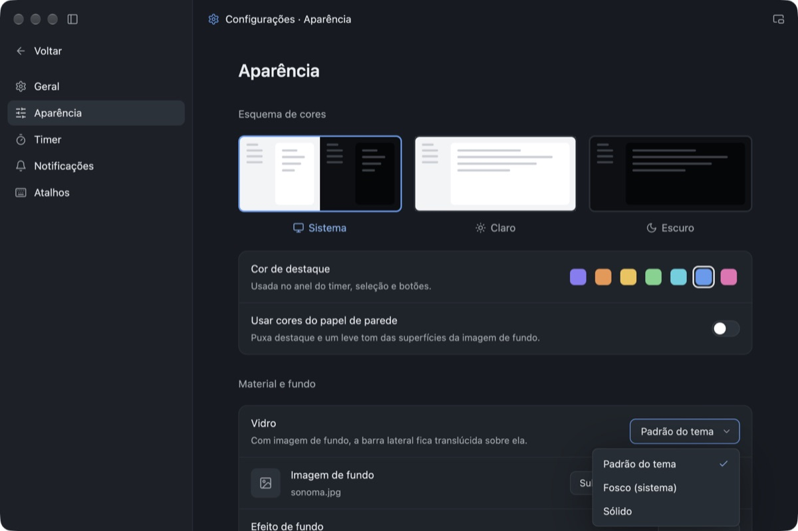
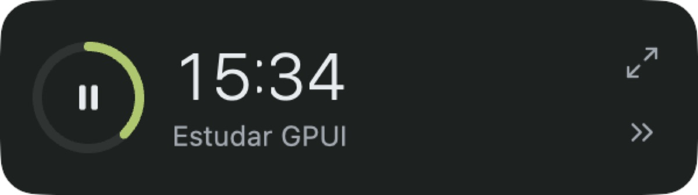
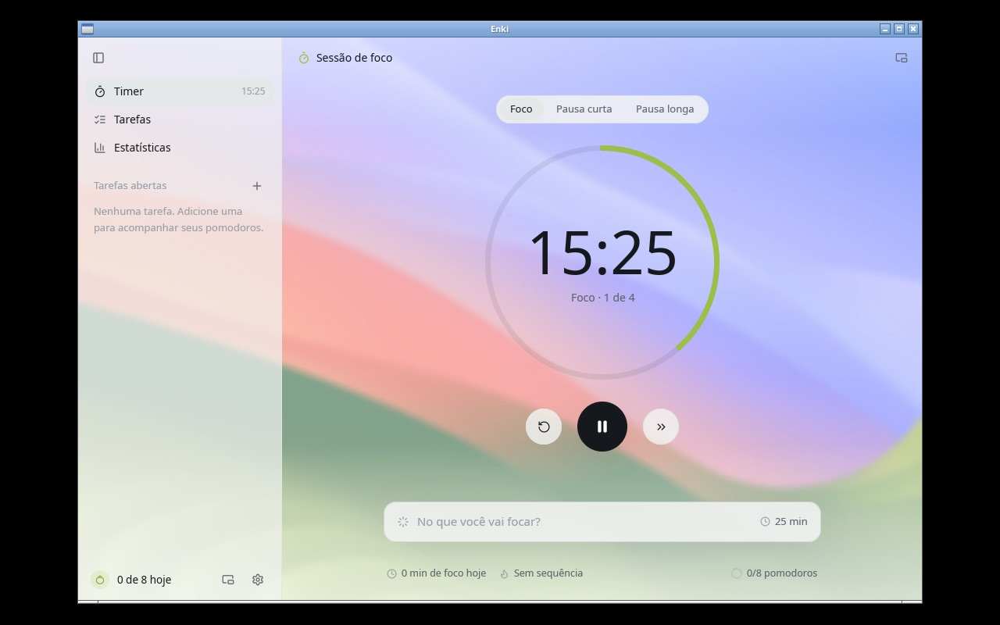

# Enki

Um timer pomodoro para macOS e Ubuntu, escrito em Rust com [GPUI](https://gpui.rs) (o framework de UI do Zed). O visual é inspirado no [Zeron](https://github.com/zeronsh/zeron): tema escuro azulado, barra lateral, cartões arredondados, cor de destaque e imagem de fundo.



| | |
| --- | --- |
|  |  |
|  |  |
|  |  |

## O que tem

- **Timer** com anel de progresso, ciclos configuráveis (foco, pausa curta, pausa longa a cada N focos), presets rápidos, extensão de `+5 min`, intenção da sessão e início automático opcional de pausas e focos.
- **Tarefas**: estimativa em pomodoros (inclusive com atalho `~N`), edição inline, reordenação, tarefa atual vinculada ao timer e contagem automática quando um foco termina.
- **Estatísticas**: foco de hoje, sequência de dias, recorde, gráficos interativos (últimos 7 dias e heatmap de 6 meses), histórico de sessões recentes, registro manual e exportação em CSV.
- **Wrapped**: retrospectiva das músicas e artistas mais ouvidos por período (7 dias, mês, ano ou tudo), com filtro para músicas ouvidas durante o foco.
- **Barra de menus (macOS) / bandeja (Ubuntu)** com o tempo restante e atalhos para iniciar, pausar, pular e reiniciar.
- **Modo mini**: janela pequena que flutua sobre as outras.
- **Música tocando agora**: mostra e controla Spotify e Apple Music (macOS) ou qualquer player MPRIS (Linux), sem login e funcionando com conta grátis, com pausa automática opcional nas pausas.
- **Aparência**: sistema/claro/escuro, 7 cores de destaque, imagem de fundo com desfoque, e "usar cores do papel de parede" (o destaque e um leve tom das superfícies vêm da imagem).
- **Vidro líquido**: no macOS 26 ou mais novo, a barra lateral flutuante, os cartões e os controles do timer usam o Liquid Glass do sistema (`NSGlassEffectView`), que refrata a imagem de fundo. No Ubuntu e em macOS mais antigos o vidro é desenhado pelo app: superfícies translúcidas com borda iluminada.
- **Feedback tátil**: no trackpad Force Touch do Mac, os botões do timer, o seletor de fase e os interruptores dão um toque, e os sliders das configurações "travam" em cada posição com um clique sentido no dedo.
- Notificações nativas e som ao fim de cada fase.

## Baixar

Os executáveis prontos para **macOS (Apple Silicon)** e **Ubuntu / Linux (x86_64)** ficam disponíveis na aba [Releases](https://github.com/RafaelMouraG/Enki/releases/latest):

### macOS

1. Baixe o `.dmg` na última release e arraste o **Enki.app** para **Aplicativos**.
2. Como o app é assinado ad-hoc (sem conta paga da Apple Developer), remova o aviso de quarentena na primeira vez:

```sh
xattr -cr /Applications/Enki.app
```

### Ubuntu / Debian

Baixe o `.deb` na última release e instale com:

```sh
sudo apt install ./enki-*-linux-amd64.deb
```

Em outras distribuições Linux, baixe o `.tar.gz` com o binário pronto.

## Compilando do código-fonte

Requer Rust estável (`rustup`).

```sh
cargo run --release
```

### macOS

Precisa do Xcode (ou das Command Line Tools). Os shaders Metal são compilados em tempo de execução (feature `runtime_shaders` do GPUI), então o "Metal Toolchain" do Xcode não é necessário.

Para gerar um `Enki.app` com ícone (assinado ad-hoc):

```sh
./scripts/bundle-macos.sh
open target/release/Enki.app
```

Para instalar em `/Applications`, com atalho no Launchpad e no Spotlight (`--dock` também fixa no Dock):

```sh
./scripts/install-macos.sh --dock
```

Na primeira vez que o cartão do Spotify for usado, o macOS pede permissão para o Enki controlar o Spotify.

### Ubuntu

Dependências de build:

```sh
sudo apt install build-essential pkg-config clang libxkbcommon-dev libxkbcommon-x11-dev \
  libwayland-dev libx11-xcb-dev libxcb1-dev libfontconfig-dev libfreetype-dev \
  libvulkan-dev libzstd-dev libssl-dev libdbus-1-dev
```

O GPUI desenha com Vulkan, então o driver de vídeo precisa suportar Vulkan (`mesa-vulkan-drivers` em placas Intel/AMD).

Para instalar no seu usuário, com atalho no menu de aplicativos:

```sh
./scripts/install-linux.sh
```

No GNOME com Wayland (padrão do Ubuntu), o modo mini abre como uma janela comum: o Wayland não deixa apps ficarem "sempre por cima" sozinhos. Para fixar, clique com o botão direito na barra de título da janela e escolha "Sempre na frente" (Super + clique arrastando também move a janela). No X11 ele flutua normalmente.

O ícone na bandeja usa o protocolo StatusNotifierItem, exibido pela extensão "AppIndicator" que já vem ativada no Ubuntu. Em um GNOME sem essa extensão, o ícone não aparece; o resto do app funciona normalmente.

## Atalhos

| Ação | Atalho |
| --- | --- |
| Iniciar / pausar | `Espaço` (ou `⌘/Ctrl + Enter`) |
| Pular fase | `S` |
| Reiniciar fase | `R` |
| Timer / Tarefas / Estatísticas / Wrapped | `⌘/Ctrl + 1 / 2 / 3 / 4` |
| Nova tarefa | `⌘/Ctrl + N` |
| Barra lateral | `⌘/Ctrl + B` |
| Modo mini | `⌘/Ctrl + Shift + M` |
| Configurações | `⌘/Ctrl + ,` |

## Onde ficam os dados

| | macOS | Linux |
| --- | --- | --- |
| Configurações | `~/Library/Application Support/Enki/settings.json` | `~/.config/Enki/settings.json` |
| Histórico (SQLite) | `~/Library/Application Support/Enki/enki.db` | `~/.local/share/Enki/enki.db` |
| Cache (fundo, capas) | `~/Library/Caches/Enki` | `~/.cache/Enki` |

`ENKI_HOME=/algum/diretório` coloca tudo em um só lugar, útil para testar sem mexer nos seus dados.

O banco usa UUIDs, `updated_at` e exclusão lógica para que a sincronização entre máquinas possa ser adicionada depois sem migração destrutiva.

## Desenvolvimento

```sh
cargo test     # lógica do timer, banco, cor dominante do fundo, formatação
cargo clippy
```

Em builds de debug, algumas variáveis ajudam a gerar screenshots:

- `ENKI_DEBUG_PAGE=tasks|stats|settings:aparência` abre direto em uma página.
- `ENKI_DEBUG_RUN=1` começa com o timer rodando.
- `ENKI_DEBUG_TASK=<trecho do título>` seleciona uma tarefa.
- `ENKI_DEBUG_MINI=1` abre o modo mini.
- `ENKI_DEBUG_MENU=glass|effect|sound` abre um dropdown das configurações.
- `ENKI_DEBUG_SYNC=1` carrega a imagem de fundo antes do primeiro quadro e desliga animações.

### Estrutura

```
src/
  main.rs        janelas (principal e mini), inicialização
  actions.rs     ações, atalhos e menus
  state.rs       modelo do app: timer, tarefas, estatísticas, serviços
  timer.rs       máquina de estados do pomodoro (lógica pura, testada)
  store.rs       SQLite: tarefas e sessões
  settings.rs    preferências em JSON
  theme.rs       tokens de design (cores, raios, fontes)
  wallpaper.rs   desfoque e cor dominante da imagem de fundo
  media.rs       "tocando agora" (AppleScript / MPRIS)
  tray.rs        barra de menus / bandeja
  notify.rs      notificações e sons
  native.rs      Liquid Glass e feedback tátil (macOS)
  ui/            páginas e componentes
```

## Créditos e licença

- **Inspiração visual:** [Zeron](https://github.com/zeronsh/zeron) (apenas inspiração de design e layout; este projeto não é afiliado ao Zeron).
- **Framework de UI:** [GPUI](https://gpui.rs) ([Zed Industries](https://github.com/zed-industries/zed), Apache-2.0) — `src/ui/text_input.rs` é adaptado do exemplo `input.rs` do GPUI.
- **Ícones:** [Lucide](https://lucide.dev) (licença ISC; porções derivadas do [Feather](https://feathericons.com), licença MIT), redesenhados com traço mais fino.

Distribuído sob a licença **MIT** — veja [LICENSE](LICENSE) e [THIRD_PARTY_NOTICES.md](THIRD_PARTY_NOTICES.md).
